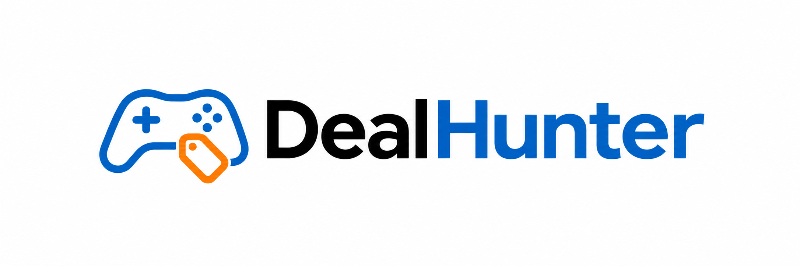

<p align="center">
  
</p>

<h1 align="center">Deal Hunter</h1>

<p align="center">
  <strong>Physical game deals across Portugal, tracked hourly.</strong><br />
  Search the RAWG catalog, watch the games you care about, compare the cheapest OLX.pt listings first.
</p>

Nuxt 4 + Tailwind + Neon Postgres + Prisma + REST. RAWG catalog + OLX.pt scraping via Playwright (Portugal). eBay deferred, alerts deferred. See ADR 0005 (partner API cannot search; scraping stays discovery).

## Glossary
See `CONTEXT.md`. Core: `Brand → Platform → Game (title×platform) → Listing → PriceSnapshot`, `User → Wishlist → WishlistEntry`. Decisions in `docs/adr/`.

## Setup
```bash
cp .env.example .env   # fill DATABASE_URL, DATABASE_URL_UNPOOLED (Neon), RAWG_API_KEY, OLX_CLIENT_ID, OLX_CLIENT_SECRET
npm install
npx playwright install chromium  # first time only — for OLX scraping
npx prisma db push     # or migrate dev
npm run dev            # http://localhost:3000
```

## Seed catalog
```bash
RAWG_API_KEY=xxx node scripts/sync-catalog.mjs
```

## Deploy (Render, manual)
`render.yaml` mirrors the settings below but is **not** applied as a Blueprint — create the service from the dashboard.

**New → Web Service** → connect `deal-hunter`:

| Setting | Value |
|---|---|
| Language / Runtime | **Docker** |
| Dockerfile Path | `./Dockerfile` |
| Region | Frankfurt |
| Branch | `main` |
| Root Directory | *(blank)* |
| Start Command | `npx prisma db push && node .output/server/index.mjs` |
| Instance Type | Starter or higher |
| Health Check Path | `/api/platforms` |
| Auto-Deploy | Yes |

No disk — the database is Neon Postgres.

Docker is required: Render's native Node runtime is non-root, so Playwright's `--with-deps` cannot install Chromium's system libraries. `mcr.microsoft.com/playwright:v1.65.1-jammy` already has them, and Chromium stays sandboxed because the image runs as `pwuser`.

**Environment variables**:
| Key | Value |
|---|---|
| `DATABASE_URL` | Neon **pooled** connection string |
| `DATABASE_URL_UNPOOLED` | Neon **direct** connection string (Prisma CLI) |
| `RAWG_API_KEY` | your key |
| `CRON_SECRET` | long random string, same as the GitHub secret |
| `OLX_CLIENT_ID` | OLX partner client id |
| `OLX_CLIENT_SECRET` | OLX partner client secret |

Seed the catalog once (locally against the same Neon database, or from the service **Shell**):
```bash
node scripts/sync-catalog.mjs
```

Then set the GitHub repo secrets:
- `APP_URL` = `https://<service>.onrender.com` (no trailing slash)
- `CRON_SECRET` = the same value the service has

Finally trigger the `refresh listings` workflow once to verify.

The database lives in Neon, independent of the Render service.

## Cron (hourly)
`.github/workflows/refresh-listings.yml` calls `POST /api/cron/refresh` every hour. The endpoint refreshes wishlisted games first, then the 10 coldest cached games (one batch per call).

Required GitHub repository secrets:
- `APP_URL` — deployed origin, no trailing slash (e.g. `https://deal-hunter.onrender.com`)
- `CRON_SECRET` — same value as the server's `CRON_SECRET`

Run it manually:
```bash
CRON_SECRET=xxx node scripts/refresh-wishlisted.mjs   # CRON_BATCH=20 to change the batch
```

## Routes
- `GET /api/platforms` — all synced platforms, brand-grouped
- `GET /api/games?q=&platform=` — catalog search (refreshes from RAWG)
- `GET /api/games/:id` — one game
- `GET /api/games/:id/listings` — cheapest first, live-fetch if empty; `?lat=&lon=` keeps only listings within 25 km (ADR 0006)
- `POST /api/cron/refresh` — hourly refresh, requires `x-cron-secret`
- Wishlist is localStorage-only; there is no wishlist API.
